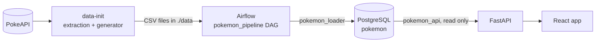
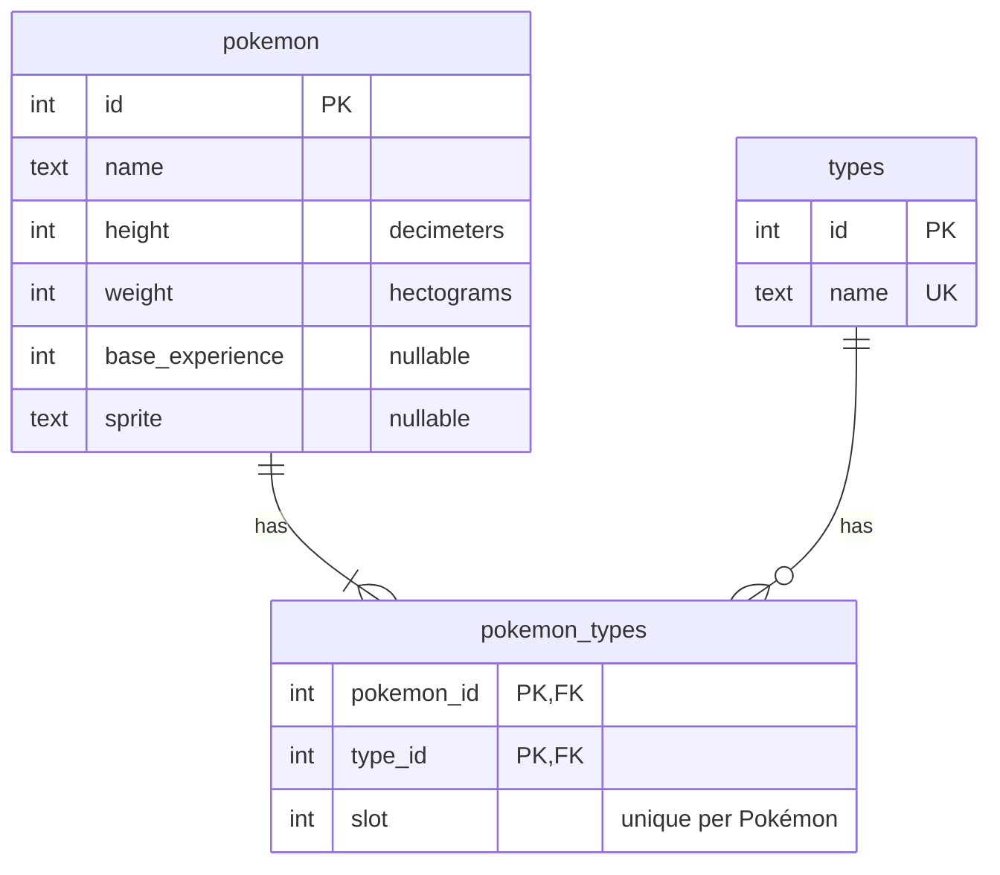

# Pokémon Explorer

A web app that lists the first 100 Pokémon and statistics about their captures. The data is downloaded from the [Pokémon API](https://pokeapi.co), extended with the provided generator, and loaded into PostgreSQL by an Apache Airflow pipeline.



## Requirements

- Docker with Docker Compose

## How to run

```bash
cp .env.example .env
docker compose up
```

`.env` holds the local passwords; Compose stops if one is missing.

| Service | Address |
|---|---|
| Web app | http://localhost:5173 |
| API | http://localhost:8000 (interactive docs at `/docs`) |
| Airflow | http://localhost:8080 (no login, local development only) |

The `pokemon_pipeline` DAG runs once by itself when Airflow starts (`@once`). To run it again, use the Trigger button in Airflow or:

```bash
docker compose exec airflow airflow dags trigger pokemon_pipeline
```

SQL console: `docker compose exec postgres psql -U postgres -d pokemon`. Reset the database: `docker compose down -v`.

## Data extraction and generation

The `data-init` service runs on `docker compose up`, before Airflow, and writes six CSV files into `./data`:

1. `extraction/` downloads the first 100 Pokémon from PokeAPI into `pokemon.csv`, `types.csv` and `pokemon_types.csv`.
2. `generator/generate_pokemon_data.py` (unmodified) writes `trainers.csv`, `captures.csv` and `battles.csv`.

Airflow starts only if `data-init` succeeds, and reads `./data` read-only.

**Errors:** timeouts, `429` and `5xx` are retried up to 4 times with exponential backoff; `404` and invalid bodies fail at once. Nothing is written until the 100 Pokémon are validated; each file is written to a temporary file and renamed, and `data/_SUCCESS` is written last.

**Running it again:** if `data/_SUCCESS` exists the download is skipped; `FORCE_EXTRACT=true docker compose up data-init` downloads again. If PokeAPI is down, place the three CSV files and an empty `_SUCCESS` in `data/` by hand.

**File owner:** `data-init` runs as root to be able to write into `./data` on any host, then gives the files to the owner of the folder so they are not left owned by root on Linux.

## Pipeline

`validate_csv` → `create_schema` → `load` → `build_views`

- **validate_csv** reads every file before touching the database. An error fails the run and nothing is loaded; a warning is logged and the row is loaded.
- **load** empties the tables and loads them again with `COPY`, in one transaction: a failure leaves the previous data in place. It checks that the database row counts match the validated files.
- **build_views** recreates the SQL views the API reads.

### Validation rules

The rules match the database constraints: a value the database would reject is an error, so the run fails at validation and names the line, instead of failing halfway through the load.

| Rule | Severity |
|---|---|
| `_SUCCESS` missing, a file missing, or a header different from the expected columns | error |
| A row with more or fewer fields than the header | error |
| An id, `height`, `weight`, `base_experience` or `slot` that is not an integer, or is below its minimum (ids and `slot` ≥ 1, the rest ≥ 0) | error |
| An empty required value | error |
| An empty `base_experience` or `sprite` (PokeAPI allows both to be null) | warning, loaded as `NULL` |
| A repeated id, a repeated type name, or a Pokémon with the same type or slot twice | error |
| A `pokemon_types` row pointing to a Pokémon or a type that does not exist | error |

### Schema



Ids are the PokeAPI ids, not generated ones, so the API and the CSV files refer to the same Pokémon.

## API

| Endpoint | Returns |
|---|---|
| `GET /items?limit=20&offset=0` | A page of Pokémon (`id`, `name`, `sprite`) and the `total`. `limit` goes from 1 to 100 |
| `GET /items/{id}` | One Pokémon with its types, in slot order |
| `GET /items/summary` | `total_pokemon` and, per type, the number of Pokémon and their average `base_experience` |
| `GET /health` | `{"status": "ok"}` |

- **Types only in the detail.** The list returns no types, as the statement asks.
- **Summary.** A Pokémon with two types counts in both, so the per-type counts add up to more than the total. That is why the response carries both. A type with no Pokémon appears with `0`. The average ignores Pokémon without `base_experience`.
- **Errors.** Every error has the same body, `{"error": {"code", "message", "details"}}`:

| Status | When |
|---|---|
| `400` | Invalid input: `/items/abc`, `limit=500`, `offset=-1` |
| `404` | A Pokémon or route that does not exist |
| `503` | The database is down (`database_unavailable`) or the pipeline has not run yet (`data_not_loaded`) |

## Web app

- `/items` shows the list (20 per page, the page is kept in the URL as `?page=`) and the summary by type. `/item/:id` shows the detail.
- An invalid id (`/item/abc`) shows "not found" without calling the API. A page beyond the last one shows an empty state with a link to the first page.
- State lives in Redux Toolkit; each page and detail is fetched once and kept. Every API response is validated with zod before reaching the state.

## Tests

Only Docker is needed. The extraction tests use a fake PokeAPI, and the pipeline tests run against a temporary PostgreSQL:

```bash
docker compose -f docker-compose.test.yml run --rm extraction-tests
docker compose -f docker-compose.test.yml run --rm pipeline-tests
docker compose -f docker-compose.test.yml run --rm api-tests
docker compose -f docker-compose.test.yml run --rm web-tests
docker compose -f docker-compose.test.yml down -v
```

## Repository layout

```
├── web/            React app, generated with `npm create vite@9.3.4 web -- --template react-ts`
├── api/            FastAPI service that reads the Pokémon database
├── pipeline/       Airflow DAG, CSV validation, schema and SQL views
├── extraction/     downloads PokeAPI data into three CSV files
├── generator/      the provided data generator, unmodified
├── database/init/  creates the databases and users, only when the data volume is empty
├── docker-compose.yml
└── docker-compose.test.yml
```

Inside each service, code is grouped by domain (`pokemon/`) with what the domains share in `shared/`, and constants split by topic in a `constants/` folder.

## Database users

| User | Database | Can |
|---|---|---|
| `airflow` | `airflow` | Airflow's internal metadata |
| `pokemon_loader` | `pokemon` | Create tables and write: used by the DAG |
| `pokemon_api` | `pokemon` | Read only: used by the API |
