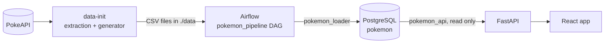
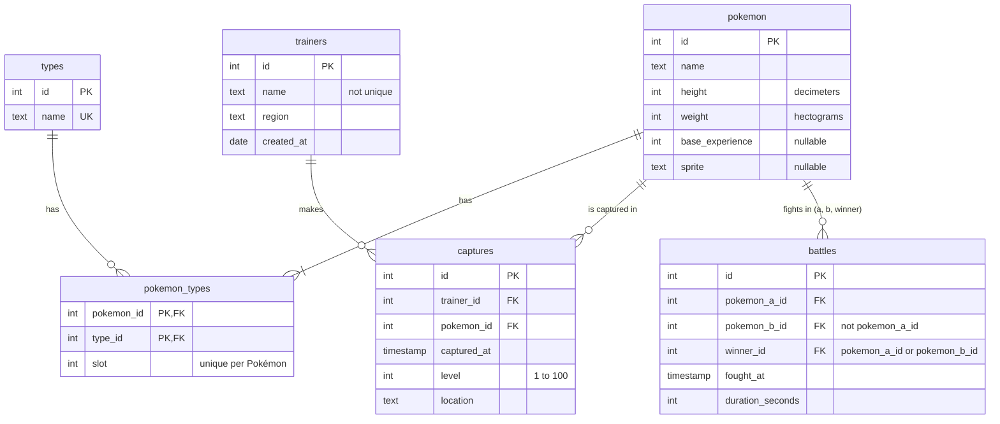

# Pokémon Explorer

A web app that lists the first 100 Pokémon and statistics about their captures. The data is downloaded from the [Pokémon API](https://pokeapi.co), extended with the provided generator, and loaded into PostgreSQL by an Apache Airflow pipeline.



## How to run

Requires Docker with Docker Compose.

```bash
cp .env.example .env
docker compose up
```

`.env` holds the local passwords; Compose stops if one is missing.

| Service | Address |
|---|---|
| Web app | http://localhost:5173 |
| API | http://localhost:8000 (interactive docs at `/docs`) |
| Airflow | http://localhost:8080 (no login, local development only) |

The `pokemon_pipeline` DAG runs once by itself when Airflow starts (`@once`). To run it again, use the Trigger button in Airflow or:

```bash
docker compose exec airflow airflow dags trigger pokemon_pipeline
```

## Data extraction and generation

The `data-init` service runs on `docker compose up`, before Airflow, and writes six CSV files into `./data`:

1. `extraction/` downloads the first 100 Pokémon from PokeAPI into `pokemon.csv`, `types.csv` and `pokemon_types.csv`.
2. `generator/generate_pokemon_data.py` (unmodified) writes `trainers.csv`, `captures.csv` and `battles.csv`.

Airflow starts only if `data-init` succeeds.

- **API errors:** timeouts, `429` and `5xx` are retried with backoff; `404` and invalid bodies fail at once. Nothing is written unless all 100 Pokémon arrive, and `data/_SUCCESS` marks a complete extraction.
- **Running it again:** the download is skipped if `data/_SUCCESS` exists; `FORCE_EXTRACT=true docker compose up data-init` downloads again. If PokeAPI is down, place the three CSV files and an empty `_SUCCESS` in `data/` by hand.
- **File owner:** `data-init` runs as root so it can write into `./data` on any host, then gives the files back to the owner of the folder.

## Pipeline

`validate_csv` → `create_schema` → `load` → `build_views`

- **validate_csv** checks every file before touching the database. An error fails the run and nothing is loaded; a warning is logged and the row is loaded.
- **load** replaces the tables with `COPY` in one transaction, so a failure leaves the previous data in place.
- **build_views** recreates the SQL views behind the summary and queries A, B and C.

### Validation rules

A value the database would reject is an error, so the run stops at validation and names the line instead of failing halfway through the load.

| Rule | Severity |
|---|---|
| `_SUCCESS` missing, a file missing or unreadable, or columns different from the expected ones | error |
| A row with more or fewer fields than the header | error |
| A number that is not an integer or is out of range: ids and `slot` ≥ 1, `height`, `weight` and `base_experience` ≥ 0, `level` from 1 to 100 | error |
| A date that is not `YYYY-MM-DD`, or a timestamp that is not `YYYY-MM-DD HH:MM:SS` | error |
| An empty required value | error |
| An empty `base_experience` or `sprite` (PokeAPI allows both to be null) | warning, loaded as `NULL` |
| A repeated id or type name, or a Pokémon with the same type or slot twice | error |
| A reference to a row that does not exist | error |
| A battle of a Pokémon against itself, or won by a Pokémon that did not fight | error |
| A battle lasting 0 seconds or less | warning |
| A capture in the future, or before its trainer was created | warning |

### Data findings

- **5 battles last 0 seconds or less** (ids 171, 231, 290, 1278 and 1813). They are loaded with a warning: no query uses the duration, and dropping or blocking them is a business decision. Making it block is one word in `pipeline/pokemon_etl/validation/rules.py`.
- **Kalos has one trainer**, so its top 3 has one row.
- **Trainer names repeat**, so every query groups by trainer id.

### Assumptions

- Levels go from 1 to 100: the statement gives no range, and both the games and the generator use it.
- Dates have no time zone (`timestamp`, not `timestamptz`), so a capture never moves to another month because of the server's zone.

### Queries

Each query is a view built by the DAG. Results on the generated data:

| Query | Decisions | Result |
|---|---|---|
| A · Monthly growth (`monthly_capture_growth`) | Every month between the first and the last capture appears, with 0 if it has none. A change with nothing to compare against is `NULL`, not 0 % | 12 months; Feb 2026 +88.81 %, Sep 2026 −41.80 % |
| B · Top trainers (`top_trainers_by_region`) | `RANK`: tied trainers share their position, so a region can show more than 3. A region without captures appears with an empty list | 16 trainers; Johto leads with 1,270, Kalos has 1 |
| C · Level classification (`high_level_captures_by_type`) | Level ≥ 50. A Pokémon with two types counts in both. A type without captures shows 0 and a `NULL` percentage | Ice is the highest, 10 of 56 (17.86 %) |

### Schema



Ids are the ids of the CSV files, so the API and the files refer to the same rows.

| Database user | Can |
|---|---|
| `pokemon_loader` | Create tables and write: used by the DAG |
| `pokemon_api` | Read only: used by the API |

## API

| Endpoint | Returns |
|---|---|
| `GET /items?limit=20&offset=0` | A page of Pokémon and the `total` (`limit` from 1 to 100) |
| `GET /items/{id}` | One Pokémon with its types, and the previous and next ids |
| `GET /items/summary` | The total and, per type, the number of Pokémon and their average `base_experience` |
| `GET /queries/monthly-growth` | Query A |
| `GET /queries/top-trainers` | Query B |
| `GET /queries/level-classification` | Query C |

- **Types only in the detail**, as the statement asks.
- **Summary:** a Pokémon with two types counts in both, so the per-type counts add up to more than the total; the response carries both.
- **Errors:** `400` for invalid input (`/items/abc`, `limit=500`), `404` for a Pokémon or route that does not exist, `503` when the database is down or the pipeline has not run yet. Every error has the body `{"error": {"code", "message", "details"}}`.

## Web app

`/items` shows the list with the summary by type, `/item/:id` the detail and `/queries` queries A, B and C. Data is fetched with `createAsyncThunk` from `useEffect`, as the statement asks, and kept in Redux Toolkit so a page or detail is not requested twice.

## Tests

Only Docker is needed:

```bash
docker compose -f docker-compose.test.yml run --rm extraction-tests
docker compose -f docker-compose.test.yml run --rm pipeline-tests
docker compose -f docker-compose.test.yml run --rm api-tests
docker compose -f docker-compose.test.yml run --rm web-tests
docker compose -f docker-compose.test.yml down -v
```

The pipeline tests run queries A, B and C on the output of the provided generator and compare them with the same numbers computed in Python.

## Repository layout

```
├── web/            React app, generated with `npm create vite@9.3.4 web -- --template react-ts`
├── api/            FastAPI service that reads the Pokémon database
├── pipeline/       Airflow DAG, CSV validation, schema and SQL views
├── extraction/     downloads PokeAPI data into three CSV files
├── generator/      the provided data generator, unmodified
└── database/init/  creates the databases and users
```
