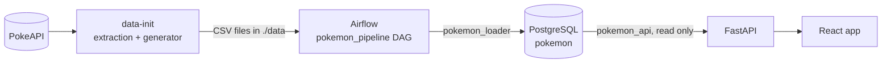
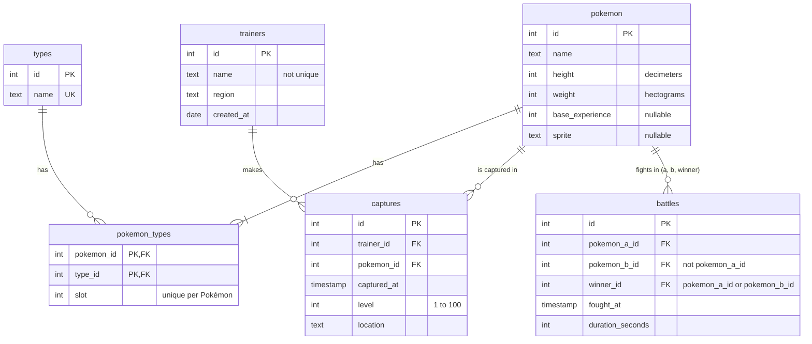

# Pokémon Explorer

A web app that lists the first 100 Pokémon and statistics about their captures. The data is downloaded from the [Pokémon API](https://pokeapi.co), extended with the provided generator, and loaded into PostgreSQL by an Apache Airflow pipeline.



## Requirements

- Docker with Docker Compose

## How to run

```bash
cp .env.example .env
docker compose up
```

`.env` holds the local passwords; Compose stops if one is missing.

| Service | Address |
|---|---|
| Web app | http://localhost:5173 |
| API | http://localhost:8000 (interactive docs at `/docs`) |
| Airflow | http://localhost:8080 (no login, local development only) |

The `pokemon_pipeline` DAG runs once by itself when Airflow starts (`@once`). To run it again, use the Trigger button in Airflow or:

```bash
docker compose exec airflow airflow dags trigger pokemon_pipeline
```

SQL console: `docker compose exec postgres psql -U postgres -d pokemon`. Reset the database: `docker compose down -v`.

## Data extraction and generation

The `data-init` service runs on `docker compose up`, before Airflow, and writes six CSV files into `./data`:

1. `extraction/` downloads the first 100 Pokémon from PokeAPI into `pokemon.csv`, `types.csv` and `pokemon_types.csv`.
2. `generator/generate_pokemon_data.py` (unmodified) writes `trainers.csv`, `captures.csv` and `battles.csv`.

Airflow starts only if `data-init` succeeds, and reads `./data` read-only.

**Errors:** timeouts, `429` and `5xx` are retried up to 4 times with exponential backoff; `404` and invalid bodies fail at once. Nothing is written until the 100 Pokémon are validated; each file is written to a temporary file and renamed, and `data/_SUCCESS` is written last.

**Running it again:** if `data/_SUCCESS` exists the download is skipped; `FORCE_EXTRACT=true docker compose up data-init` downloads again. If PokeAPI is down, place the three CSV files and an empty `_SUCCESS` in `data/` by hand.

**File owner:** `data-init` runs as root to be able to write into `./data` on any host, then gives the files to the owner of the folder so they are not left owned by root on Linux.

## Pipeline

`validate_csv` → `create_schema` → `load` → `build_views`

- **validate_csv** reads every file before touching the database. An error fails the run and nothing is loaded; a warning is logged and the row is loaded.
- **load** empties the tables and loads them again with `COPY`, in one transaction: a failure leaves the previous data in place. It checks that the database row counts match the validated files.
- **build_views** recreates the SQL views the API reads.

### Validation rules

The rules match the database constraints: a value the database would reject is an error, so the run fails at validation and names the line, instead of failing halfway through the load. Rules that compare columns or tables only run on rows whose values are valid, so one bad value is reported once.

| Rule | Severity |
|---|---|
| `_SUCCESS` missing, a file missing, or a header different from the expected columns | error |
| A row with more or fewer fields than the header | error |
| An integer column with something else, or out of range: ids and `slot` ≥ 1, `height`, `weight` and `base_experience` ≥ 0, `level` from 1 to 100 | error |
| A `created_at` that is not `YYYY-MM-DD`, or a `captured_at` or `fought_at` that is not `YYYY-MM-DD HH:MM:SS` | error |
| An empty required value | error |
| An empty `base_experience` or `sprite` (PokeAPI allows both to be null) | warning, loaded as `NULL` |
| A repeated id, a repeated type name, or a Pokémon with the same type or slot twice | error |
| A reference to a row that does not exist (`pokemon_types`, `captures`, `battles`) | error |
| A battle of a Pokémon against itself, or won by a Pokémon that did not fight | error |
| A battle lasting 0 seconds or less | warning |
| A capture in the future, or before its trainer was created | warning |

### Data findings

- **5 battles last 0 seconds or less** (ids 171, 231, 290, 1278 and 1813). They are loaded and logged as a warning: no query uses the duration, the dataset is fixed, and dropping or blocking them is a business decision. Making it block is one word in `pipeline/pokemon_etl/validation/rules.py`.
- **Kalos has one trainer**, so its top 3 has one row.
- **Trainer names repeat**, so every query groups by trainer id.

### Assumptions

- Levels go from 1 to 100: the statement gives no range, and both the games and the generator use it.
- Dates have no time zone (`timestamp`, not `timestamptz`), so a capture never moves to another month because of the server's zone.

### Queries

Each query is a view built by the DAG; the API only selects from it and sets the order. Results on the generated data:

| Query | View | Decisions | Result |
|---|---|---|---|
| A · Monthly growth | `monthly_capture_growth` | Every month between the first and the last capture appears, with 0 if it has none. The first month, and a month after one with 0 captures, have a `NULL` change: there is nothing to compare with, and 0 % would mean "no change" | 12 months; Feb 2026 +88.81 %, Sep 2026 −41.80 % |
| B · Top trainers | `top_trainers_by_region` | `RANK`: tied trainers share their position, so a region can show more than 3. Picking one by id would leave a trainer out for no reason related to captures. A region whose trainers have no captures appears with an empty list | 16 trainers; Johto leads with 1,270, Kalos has 1 |
| C · Level classification | `high_level_captures_by_type` | Level ≥ 50. A Pokémon with two types counts in both. A type without captures appears with 0 and a `NULL` percentage | Ice is the highest, 10 of 56 (17.86 %) |

### Schema



Ids are the ids of the CSV files, not generated ones, so the API and the files refer to the same rows. `captures` has an index on each foreign key, used by queries B and C.

## API

| Endpoint | Returns |
|---|---|
| `GET /items?limit=20&offset=0` | A page of Pokémon (`id`, `name`, `sprite`) and the `total`. `limit` goes from 1 to 100 |
| `GET /items/{id}` | One Pokémon with its types, in slot order |
| `GET /items/summary` | `total_pokemon` and, per type, the number of Pokémon and their average `base_experience` |
| `GET /queries/monthly-growth` | Query A: `{"months": [...]}` |
| `GET /queries/top-trainers` | Query B: `{"regions": [{"region", "trainers": [...]}]}` |
| `GET /queries/level-classification` | Query C: `{"types": [...]}` |
| `GET /health` | `{"status": "ok"}` |

- **Types only in the detail.** The list returns no types, as the statement asks.
- **Summary.** A Pokémon with two types counts in both, so the per-type counts add up to more than the total. That is why the response carries both. A type with no Pokémon appears with `0`. The average ignores Pokémon without `base_experience`.
- **Errors.** Every error has the same body, `{"error": {"code", "message", "details"}}`:

| Status | When |
|---|---|
| `400` | Invalid input: `/items/abc`, `limit=500`, `offset=-1` |
| `404` | A Pokémon or route that does not exist |
| `503` | The database is down (`database_unavailable`) or the pipeline has not run yet (`data_not_loaded`) |

## Web app

- `/items` shows the list (20 per page, the page is kept in the URL as `?page=`) and the summary by type. `/item/:id` shows the detail. `/queries` shows queries A, B and C, with ties marked in B.
- An invalid id (`/item/abc`) shows "not found" without calling the API. A page beyond the last one shows an empty state with a link to the first page.
- State lives in Redux Toolkit; each page and detail is fetched once and kept. Every API response is validated with zod before reaching the state.

## Tests

Only Docker is needed. The extraction tests use a fake PokeAPI. The pipeline tests run against a temporary PostgreSQL, and check queries A, B and C on the output of the provided generator against the same numbers computed in Python from the CSV files:

```bash
docker compose -f docker-compose.test.yml run --rm extraction-tests
docker compose -f docker-compose.test.yml run --rm pipeline-tests
docker compose -f docker-compose.test.yml run --rm api-tests
docker compose -f docker-compose.test.yml run --rm web-tests
docker compose -f docker-compose.test.yml down -v
```

## Repository layout

```
├── web/            React app, generated with `npm create vite@9.3.4 web -- --template react-ts`
├── api/            FastAPI service that reads the Pokémon database
├── pipeline/       Airflow DAG, CSV validation, schema and SQL views
├── extraction/     downloads PokeAPI data into three CSV files
├── generator/      the provided data generator, unmodified
├── database/init/  creates the databases and users, only when the data volume is empty
├── docker-compose.yml
└── docker-compose.test.yml
```

Inside each service, code is grouped by domain (`pokemon/` and `stats/`) with what the domains share in `shared/`, and constants split by topic in a `constants/` folder.

## Database users

| User | Database | Can |
|---|---|---|
| `airflow` | `airflow` | Airflow's internal metadata |
| `pokemon_loader` | `pokemon` | Create tables and write: used by the DAG |
| `pokemon_api` | `pokemon` | Read only: used by the API |
